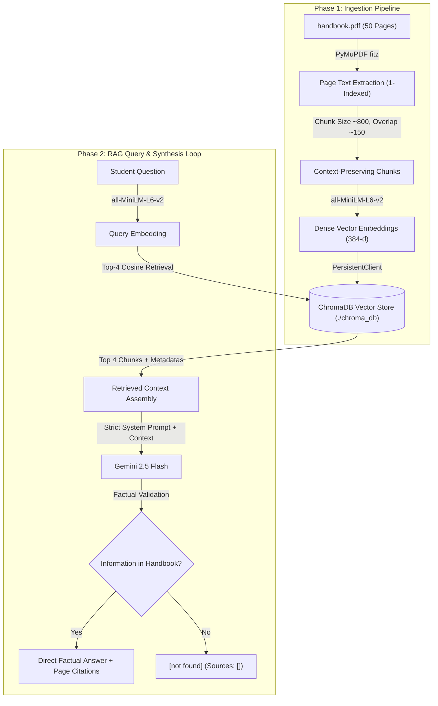

# Mirai School of Technology Policy Advisor

A robust, enterprise-grade Retrieval-Augmented Generation (RAG) system built to answer student queries regarding academic integrity, attendance, examination eligibility, fee clearances, medical leaves, and campus governance using strictly verified evidence from the **Mirai School of Technology Academic & Hostel Policy Handbook** (`handbook.pdf`).

---

## Table of Contents
1. [Project Overview](#project-overview)
2. [RAG Architecture & Workflow](#rag-architecture--workflow)
3. [Core Technical Components](#core-technical-components)
   - [PDF Extraction (PyMuPDF)](#1-pdf-extraction)
   - [Text Chunking Strategy](#2-text-chunking-strategy)
   - [Embedding Generation](#3-embedding-generation)
   - [Vector Database Persistence (ChromaDB)](#4-chromadb-persistence)
   - [Google Gemini API Integration](#5-google-gemini-integration)
4. [Installation & Execution Guide](#installation--execution-guide)
5. [Environment Variables](#environment-variables)
6. [Assessment Evaluation (5 Mandatory Questions)](#assessment-evaluation)
7. [Interactive Terminal CLI & Streamlit UI](#interactive-terminal-cli--streamlit-ui)
8. [Project File Structure](#project-file-structure)

---

## Project Overview

The **University Academic & Hostel Policy Advisor** addresses a common failure mode in AI-powered campus chatbots: **hallucination of institutional regulations**. Academic handbooks contain strict quantitative thresholds, deadlines, and punitive debarment rules where fabricated or approximated information can misguide students and cause severe disciplinary penalties.

This application enforces a **zero-hallucination policy**:
- Every answer is retrieved from the embedded 50-page official handbook.
- If a query asks about unmentioned facilities (e.g., swimming pool fees) or unauthorized credentials (e.g., Wi-Fi passwords), the system outputs exactly `[not found]` and returns an empty source citation list `[]`.
- All supported answers cite their exact handbook page references (e.g., `[7]`, `[24]`, `[38]`).

---

## RAG Architecture & Workflow

The system follows a two-phase architecture: **Ingestion Pipeline** and **Retrieval & Synthesis Loop**.



---

## Core Technical Components

### 1. PDF Extraction
- **Library**: `PyMuPDF` (`fitz`).
- **File**: `handbook.pdf` (50 pages).
- **Strategy**: Extracts complete raw text per page while preserving natural 1-indexed document page numbering (`page_number = page_idx + 1`).
- **Resilience**: Gracefully discards empty/whitespace pages and handles malformed PDF streams with try-except blocks.

### 2. Text Chunking Strategy
- **Chunk Size**: Approximately 800 characters.
- **Overlap**: Approximately 150 characters.
- **Boundary Preservation**: Chunks are split on natural typographical boundaries in decreasing priority order:
  1. Paragraph breaks (`\n\n`)
  2. Line breaks (`\n`)
  3. Sentence terminators (`. `)
  4. Word spaces (` `)
- **Metadata**: Each chunk carries immutable metadata:
  ```json
  {
    "page": 7,
    "chunk_id": "page_7_chunk_2",
    "source": "handbook.pdf"
  }
  ```
- **Total Produced**: 146 distinct chunks across the 50-page corpus without information loss.

### 3. Embedding Generation
- **Embedding Model**: `sentence-transformers/all-MiniLM-L6-v2`.
- **Dimensions**: 384-dimensional dense semantic vectors.
- **Integration**: Integrated via ChromaDB's native `SentenceTransformerEmbeddingFunction`, with offline fallback caching (`HF_HUB_OFFLINE=1`, `TRANSFORMERS_OFFLINE=1`).

### 4. ChromaDB Persistence
- **Client**: `chromadb.PersistentClient(path="./chroma_db")`.
- **Collection Name**: `mirai_handbook`.
- **Caching Logic**: The ingestion process checks `collection.count()`. If the collection already contains indexed documents, regeneration is skipped to enable instant application startups.
- **Index Rebuild**: Supports complete index recreation via `--rebuild` flag or the Streamlit sidebar action.

### 5. Google Gemini API Integration
- **SDK**: `google-genai` (version 1.47.0+).
- **Default Model**: `gemini-2.5-flash`.
- **Strict Grounding Directive**:
  ```text
  You are the Mirai University Academic and Hostel Policy Advisor. Answer only using the supplied context retrieved from handbook.pdf. Do not use external knowledge, assumptions, or guesses. If the context does not explicitly support an answer, output exactly [not found].
  ```
- **Deterministic Sampling**: `temperature=0.0` ensures maximum factual stability, zero creative variation, and exact repetition of required tokens.

---

## Installation & Execution Guide

### 1. Prerequisites
- Python 3.9+ installed on macOS / Linux / Windows.
- Google Gemini API key obtained from [Google AI Studio](https://aistudio.google.com/apikey).

### 2. Virtual Environment Setup
```bash
# Clone or navigate into the project workspace
cd /Users/vinaykumar/mirai-policy-advisor

# Create virtual environment (if not already existing)
python3 -m venv venv

# Activate virtual environment
source venv/bin/activate  # On Windows: .\venv\Scripts\activate

# Install required dependencies
pip install -r requirements.txt
```

### 3. Environment Configuration
Create a `.env` file from `.env.example`:
```bash
cp .env.example .env
```
Edit `.env` and supply your actual Gemini API key:
```env
GEMINI_API_KEY=your_actual_api_key_here
GEMINI_MODEL=gemini-2.5-flash
```

### 4. Ingest the Handbook
Ingest `handbook.pdf` into the local ChromaDB vector store:
```bash
python ingest.py
```
*(To rebuild the index from scratch, pass the `--rebuild` flag: `python ingest.py --rebuild`)*

### 5. Run the Automated Test Suite
Verify that all 5 assessment questions execute correctly and produce `assessment_results.json`:
```bash
python test_rag.py
```

### 6. Launch the Interactive Terminal CLI (Recommended)
Launch the interactive terminal interface:
```bash
python cli.py
```
*(Or simply: `python rag.py`)*

You can also run direct single-shot queries from the terminal:
```bash
python cli.py "I have 72% attendance this semester. How many attendance marks will I receive, and am I eligible to appear for the final examination?"
```
Or run presets using numbers `1` through `5`:
```bash
python cli.py 1
```

### 7. Optional: Launch the Streamlit Web Application
If you prefer a browser interface:
```bash
streamlit run app.py
```
Open your browser to `http://localhost:8501`.

---

## Environment Variables

| Variable | Required | Description | Example |
| :--- | :---: | :--- | :--- |
| `GEMINI_API_KEY` | **Yes** | Google Gemini API key from AI Studio | `AIzaSy...` |
| `GEMINI_MODEL` | No | Target Gemini model identifier | `gemini-2.5-flash` |
| `HF_HUB_OFFLINE` | No | Prevents redundant HuggingFace network requests | `1` |
| `TRANSFORMERS_OFFLINE`| No | Prevents transformer model check calls | `1` |

---

## Assessment Evaluation

Below is the verification audit log evaluating the 5 official assessment questions against the handbook:

| ID | Assessment Question | Expected Behavior | Actual Generated Answer | Sources | Status |
|:---|:---|:---|:---|:---:|:---:|
| **Q1** | I have 72% attendance this semester. How many attendance marks will I receive, and am I eligible to appear for the final examination? | 4 marks; strictly debarred from exam unless condoned up to 15% via medical exemption. | With 72% attendance, you will receive 4 marks in the attendance evaluation tier. You are strictly DEBARRED (not eligible) from appearing in the Final Exam for that subject, as 72% is below the mandatory 75% eligibility threshold, unless condoned via an approved medical exemption buffer (up to 15%). | `[7]` | **PASS** |
| **Q2** | Within how many days after recovery must a student submit supporting documents for Medical Leave? What happens if the documents are submitted after this period? | Within 7 days of recovery to Campus Manager. If submitted late, strictly rejected with zero relaxation and treated as unauthorized absence. | All supporting documents for Medical Leave must be submitted to the Campus Manager within 7 days of recovery (counted from the last day of illness or treatment). If requests are submitted after the 7-day window, they will not be accepted under any circumstances. The absence will be treated as a regular unauthorized absence and will count against the student’s attendance percentage with zero relaxation granted, even if the illness was genuine. | `[24]` | **PASS** |
| **Q3** | What is the monthly subscription fee for using the campus swimming pool and indoor squash court? | Not found in handbook. Must output `[not found]` with empty sources list. | `[not found]` | `[]` | **PASS** |
| **Q4** | What minimum percentage of batch-student support is required to propose a new student club, and which authority reviews the proposal first? | At least 40% batch support. First reviewed by designated Faculty Coordinator before forwarding to Management. | To propose a new student club, students must demonstrate verifiable support from at least 40% of the total batch students. The formal proposal and budget must first be submitted to the designated Faculty Coordinator for initial review and feasibility approval. | `[38]` | **PASS** |
| **Q5** | What is the default WPA2 password for the Mirai_Student_5G campus Wi-Fi network? | Not found in handbook. Must output `[not found]` with empty sources list. | `[not found]` | `[]` | **PASS** |

*All results are recorded in [assessment_results.json](file:///Users/vinaykumar/mirai-policy-advisor/assessment_results.json).*

---

## Interactive Terminal CLI & Streamlit UI

### 1. Interactive Terminal CLI (`cli.py`)
The primary interface for this system is an interactive terminal CLI built with `rich`:
- **Welcome Banner**: Displays system and model parameters.
- **Preset Shortcuts**: Simply type `1` through `5` and press Enter to run any evaluation question immediately.
- **Custom Questions**: Type any natural language question to get a real-time grounded response.
- **Commands**:
  - `help` / `?`: View command cheat sheet
  - `examples` / `ex`: View all preset questions with summaries
  - `about` / `info`: View ChromaDB and Gemini model statistics
  - `clear` / `cls`: Clear screen
  - `exit` / `quit` / `q`: Exit CLI
- **Single-Shot Mode**: Run `python cli.py "Your Question"` or `python cli.py 1` directly from the shell.

### 2. Streamlit Web Interface (`app.py`)
A secondary browser interface built with Streamlit:
- Run: `streamlit run app.py` (Local URL: `http://localhost:8501`)
- Features dark theme, responsive example buttons, expandable sidebars, and citation cards.

---

## Project File Structure

```
mirai-policy-advisor/
├── handbook.pdf                 # 50-page official institutional policy corpus
├── chroma_db/                   # Persistent ChromaDB vector database files
├── ingest.py                    # PDF extraction, chunking, and ChromaDB indexing
├── rag.py                       # RAG retrieval logic and Gemini synthesis
├── cli.py                       # Interactive terminal CLI advisor (Rich UI)
├── app.py                       # Streamlit web interface
├── test_rag.py                  # Automated test suite for the 5 evaluation questions
├── test_shortcuts.py            # AppTest suite for shortcut interactions
├── assessment_results.json      # Structured test output log
├── requirements.txt             # Complete Python package dependency manifest
├── .env                         # Local environment file with active GEMINI_API_KEY
├── .env.example                 # Sanitized template for environment configuration
├── .gitignore                   # Excludes .env, virtualenv, and Python cache files
└── README.md                    # Comprehensive technical documentation
```
